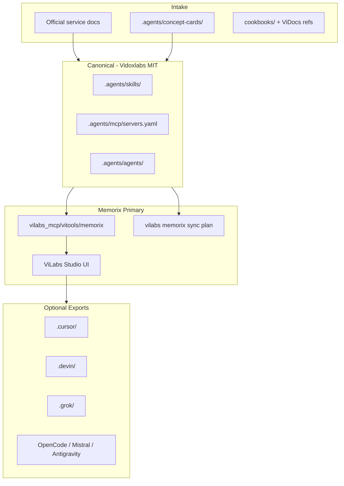

# ViTools Rewrite Agent and Memorix-Primary Sync

## Executive Summary

Establish a legal-first rewrite pipeline scoped to the **stable vitools MCP tooling fleet**
(`vilabs/tools/vilabs_mcp/vitools/`). Produce original Vidoxlabs-native skills and MCP metadata in
`.agents/` for **Memorix** to index and serve. Cross-platform exports (Cursor, Devin, Grok,
OpenCode, Mistral Vibe, Antigravity) are **optional secondary outputs** orchestrated from ViLabs
Studio via `vilabs_cli memorix`—not a standalone `vitools-sync` CLI.

**Out of scope for this plan:** broad vendoring quarantine of the vitools git repo `skills/` and
`plugins/` mirror (~37 packages). That is documented as separate future work (ADR-0003).

---

## Alignment with ViLabs Studio + Memorix Framework (2026-06-17 Review)

See [alignment review](2026-06-17-vitools-rewrite-plan-alignment-review.md) for full detail.

**Strengths retained:** legal-first rewrite model, `.agents/` canonical boundary, Vidoxlabs skill
template, phased delivery, MCP `servers.yaml` schema.

**Scope corrections:**

- Primary target is the **MCP fleet** in `vilabs_mcp/vitools/`, not the skills/plugins reference
  mirror in this git repo.
- Post-CRS consolidation: all drift/MCP/telemetry operations flow through **`vilabs_cli`**
  (`vilabs_cli.crs` inlined).
- **Memorix is primary**; platform emitters are Studio-selectable exports.
- Phase 0 does **not** bulk-move 37 vendored plugins—MCP fleet is already Vidoxlabs-native.

**Five recommendations applied:**

1. Scope Phase 0 to MCP fleet + `.agents/` skeleton.
2. Memorix indexes `.agents/skills/`, `.agents/mcp/servers.yaml`, concept cards.
3. Extend `vilabs memorix` command group; MCP tools under `vilabs_mcp/vitools/`.
4. Studio orchestrates rewrites and optional exports.
5. When no vendored content exists in MCP scope, Phase 0 = native pipeline + Memorix hooks.

---

## Scope Statement

| In scope                                                       | Out of scope                                                         |
| -------------------------------------------------------------- | -------------------------------------------------------------------- |
| `vilabs/tools/vilabs_mcp/vitools/` MCP integrations (26 tools) | `vitools/skills/` and `vitools/plugins/` vendored mirror quarantine  |
| `.agents/` canonical layer in vitools git repo                 | Replacing stable production `.mjs`/Python MCP server implementations |
| Memorix ingest of skills + MCP metadata                        | New top-level CLI outside `vilabs memorix`                           |
| Legal gate CI for archive → agent path blocking                | Bulk rewrite of third-party Cursor plugin ecosystems                 |
| Optional platform emitters via Studio                          | `vitools-sync` standalone package                                    |

Core production MCP tools (Python FastMCP workers, `mcp.json` manifests) remain stable and will be
**enhanced** with Memorix integration—not rewritten.

---

## Current State (2026-06-17)

| Area             | State                                                                              |
| ---------------- | ---------------------------------------------------------------------------------- |
| MCP fleet        | `vilabs/tools/vilabs_mcp/vitools/` — 26 tool directories, Vidoxlabs MIT            |
| Memorix          | `vilabs_mcp/vitools/memorix/` — CLI + MCP server; `vilabs memorix *` in vilabs_cli |
| CRS              | Inlined into `vilabs_cli.crs`; `vilabs drift analyze` for scope checks             |
| vitools git repo | Skills/plugins reference mirror + governance stubs; `.agents/` not yet present     |
| Studio           | `vilabs_web` Memorix API routes; agent_intel module for agent hub                  |

---

## Recommended Architecture

### Canonical layer: `.agents/` (Memorix-primary)



### Directory layout (vitools git repo)

```
vitools/
  .agents/                    # CANONICAL — Memorix indexes this
    skills/<slug>/SKILL.md
    mcp/servers.yaml
    agents/<name>.md
    concept-cards/<id>.yaml
    README.md
  archive/
    vendor/                   # Reference-only; empty for MCP scope
      MANIFEST.json
      .gitattributes
  decisions/
    0003-vitools-rewrite-scope-clarification.md
  .plans/
    NAVIGATION.md
    superpowers/plans/2026/06/17/...
  AGENTS.md
```

MCP server implementations remain in `vilabs/tools/vilabs_mcp/vitools/<tool>/`.

---

## Memorix Integration Strategy

### Indexing

Memorix ingests and indexes:

- **`.agents/skills/`** — skill procedures, triggers, guardrails for context-aware retrieval across
  7 temporal horizons.
- **`.agents/mcp/servers.yaml`** — canonical MCP registry with `evidence` URLs linking to official
  documentation.
- **`.agents/concept-cards/`** — provenance metadata only (intent patterns, no vendor excerpts).

Working-set ingest flows through `vilabs_mcp/vitools/memorix/working_set_ingest.py` and
`vilabs memorix sync plan`.

### Rewrite orchestration logging

The rewrite-orchestrator and legal gate log decisions into Memorix execution collections:

- Concept card approvals
- Legal gate pass/fail with overlap scores
- Promotion lifecycle transitions (Intake → Promoted)

### Studio visualization

ViLabs Studio (`vilabs_web` agent_intel + Memorix routes) provides:

- Skill graph visualization (skills ↔ MCP tools ↔ agents)
- Rewrite trigger UI (docs-first skill authoring)
- Optional platform export selector (not auto-sync)

### Integration points

| Component                  | Integration                                               |
| -------------------------- | --------------------------------------------------------- |
| `.agents/skills/`          | Memorix search/query; skill suggestions in agent sessions |
| `.agents/mcp/servers.yaml` | MCP tool discovery; links to `mcp.json` in fleet dirs     |
| `vilabs memorix sync plan` | Plans ingest of canonical layer changes                   |
| `vilabs memorix health`    | Pre-flight before promotion                               |
| `vilabs drift analyze`     | Scope/drift confirmation on vitools paths                 |
| `memorix_mcp` server       | Runtime retrieval for agents                              |
| Legal gate CI              | Blocks archive → `.agents/` contamination                 |

---

## Delivery Mechanism (reframed)

**Primary:** `vilabs_cli memorix` command group + MCP tools in `vilabs_mcp/vitools/`.

| Capability               | Delivery path                                                                             |
| ------------------------ | ----------------------------------------------------------------------------------------- |
| Index canonical layer    | `vilabs memorix sync plan` → `sync run` (gated)                                           |
| Query skills/MCP context | `vilabs memorix` via MCP; `memorix_mcp` server                                            |
| Rewrite orchestration    | Agent: `agents/rewrite-orchestrator.md`; future MCP tool in `vilabs_mcp/vitools/tools/`   |
| Legal overlap check      | CI workflow + future `vilabs memorix` subcommand                                          |
| Platform export          | **Optional** — `vilabs memorix export --platform cursor` (Phase 3); triggered from Studio |

**Not building:** standalone `vitools-sync` CLI package.

---

## Legal-First Rewrite Model

Unchanged principles; scoped to MCP fleet + new `.agents/` authoring:

1. Concept cards capture intent patterns—not vendor text.
2. Rewrite uses official service documentation as primary evidence.
3. `archive/vendor/` is reference-only; CI blocks emission to `.agents/`.
4. Overlap gate: >15% shared 5-grams or >80 char identical substrings vs archive → block.

For MCP scope (2026-06-17): **no vendored third-party content** exists in the fleet; legal gate
establishes preventive CI for future intake.

---

## Phased Delivery

### Phase 0 — Legal foundation + Memorix hooks (current)

- Confirm scope via `vilabs drift analyze` on vitools MCP paths
- Create `archive/vendor/MANIFEST.json` documenting MCP fleet (no quarantine moves needed)
- Add `archive/vendor/.gitattributes` (reference-only)
- Add `.github/workflows/vitools-legal-gate.yml`
- Scaffold `.agents/` with README and `mcp/servers.yaml` skeleton
- Create root `AGENTS.md` and ADR-0003

### Phase 1 — Canonical scaffold + Memorix ingest

- Populate `.agents/skills/` from Vidoxlabs-native skills (skill-mining, skills-template,
  evidence-answering, v37-validation, vidoxlabs-core-architect)
- Wire Memorix working-set ingest for `.agents/` changes
- `vilabs memorix sync plan` integration test

### Phase 2 — Rewrite orchestrator + legal gate

- `agents/rewrite-orchestrator.md` + `.agents/skills/vitools-rewrite/SKILL.md`
- Concept card pipeline; overlap scanner in CI
- Pilot: docs-first skill for one MCP tool (e.g. `vidocs_knowledge`)

### Phase 3 — Optional platform emitters

- `vilabs memorix export --platform <name>` translating `.agents/mcp/servers.yaml`
- Studio export UI; integration test per platform

### Phase 4 — Batch governance (ongoing)

- Docs-first MCP skill authoring for remaining fleet tools
- Instructions lifecycle promotion
- Separate future workstream for skills/plugins mirror quarantine (if pursued)

---

## Success Criteria

1. Zero agent-facing artifacts sourced from `archive/vendor/` (CI enforced).
2. All `.agents/` skills pass Vidoxlabs template + Legal Gate before Promoted.
3. **Memorix indexes `.agents/`** — skills and MCP entries discoverable via query/search.
4. **Rewrite decisions logged** in Memorix for temporal analysis.
5. **Studio can trigger optional platform export** without it being the default path.
6. New MCP integration creatable from official docs in one agent workflow.
7. Provenance traceable: every `.agents/` artifact links to concept card + official evidence.

---

## Phase 0 Evidence Log

**Drift analysis (2026-06-17):**

```text
Command: vilabs drift analyze
CWD: vilabs/tools/vilabs_cli
Output: review_packets=0 implementation_sweeps=0 artifact_format=dual
Report: vilabs/tools/vilabs_cli/runtime/reports/drift-analysis
```

**MCP fleet license scan:** 24 tools with Vidoxlabs MIT LICENSE; `memorix` and `standards` without
LICENSE file (native code). No third-party vendored plugin trees in scope.

**Phase 0 conclusion:** Establish native authoring pipeline + Memorix hooks; defer bulk quarantine.
